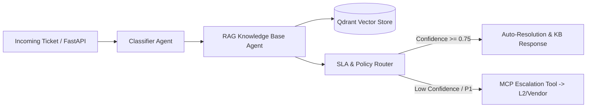

# Autonomous Enterprise Support & Triage Agent

[](https://www.python.org/)
[](https://langchain-ai.github.io/langgraph/)
[](https://fastapi.tiangolo.com/)
[](https://qdrant.tech/)
[](LICENSE)

A production-oriented **multi-agent enterprise support and ticket triage system** built with **LangGraph**, **Model Context Protocol (MCP)** tool interfaces, **FastAPI**, and **Qdrant** vector search. It classifies incoming IT/application support tickets, retrieves grounded Knowledge Base (KB) solutions via RAG, evaluates SLA urgency, and either auto-resolves or escalates with structured diagnostic context.

---

## Architecture



## Key Features

- **Stateful Multi-Agent Orchestration (`LangGraph`):** Deterministic state transitions across classification, RAG retrieval, SLA evaluation, and escalation.
- **MCP Tool Abstraction:** Standardized tool interfaces (`search_knowledge_base`, `check_sla_policy`, `escalate_ticket`) for clean integration with external ticketing or DevOps systems.
- **SLA-Aware Routing:** Automatically prioritizes P1/security incidents and enforces response-time thresholds.
- **Production API & Containerization:** FastAPI service with Pydantic validation, Docker Compose (App + Qdrant), and GitHub Actions CI.

## Project Structure

```text
autonomous-support-triage-agent/
├── .github/workflows/ci.yml   # Automated test & syntax CI
├── src/
│   ├── __init__.py
│   ├── config.py              # Environment & service settings
│   ├── models.py              # Pydantic schemas & LangGraph state
│   ├── mcp_tools.py           # MCP-style KB, SLA, and escalation tools
│   ├── graph.py               # LangGraph multi-agent triage workflow
│   └── main.py                # FastAPI entrypoint
├── tests/
│   └── test_triage.py         # Unit & API tests
├── .env.example
├── .gitignore
├── Dockerfile
├── docker-compose.yml
├── LICENSE
└── requirements.txt
```

## Quickstart

### 1. Local Setup
```bash
git clone https://github.com/nazmulahmedsolaiman/autonomous-support-triage-agent.git
cd autonomous-support-triage-agent
python -m venv .venv
source .venv/bin/activate  # On Windows: .venv\Scripts\activate
pip install -r requirements.txt
cp .env.example .env
uvicorn src.main:app --reload
```

### 2. Docker Compose (App + Qdrant)
```bash
docker compose up --build
```
Open Swagger UI at `http://localhost:8000/docs`.

### 3. Example API Request
```bash
curl -X POST http://localhost:8000/api/v1/triage \
  -H "Content-Type: application/json" \
  -d '{
    "ticket_id": "INC-1042",
    "user_email": "employee@company.com",
    "subject": "VPN connection drops after MFA prompt",
    "description": "Remote user cannot stay connected to corporate VPN for more than 30 seconds."
  }'
```

## Running Tests
```bash
pytest -v
```
